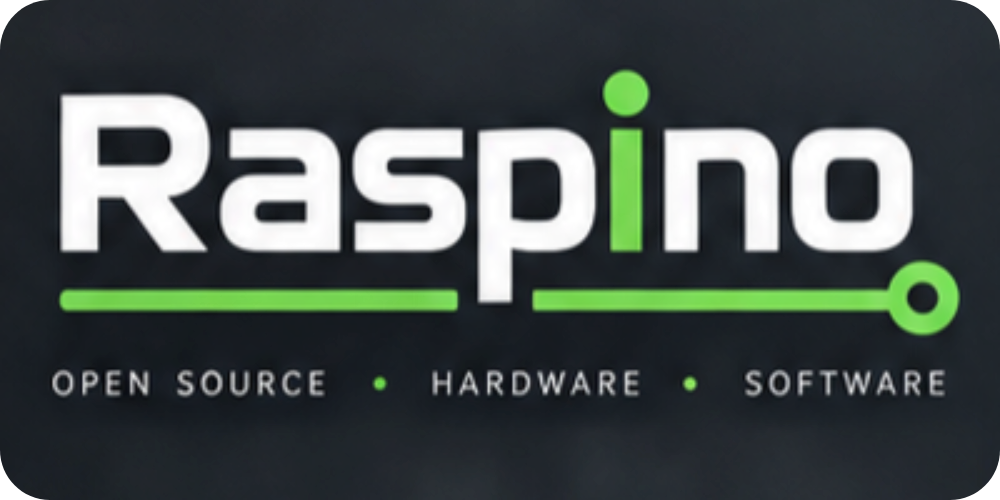

 

C++ on the Raspberry Pi, as easy as Arduino.

  

Raspino offers a lightweight, deterministic C++ framework for low-level hardware control on Linux and Raspberry Pi, featuring zero runtime heap allocations and Arduino-inspired syntax.

🌐 **Website & Documentation:** [raspino.org](https://raspino.org)  
📧 **Contact:** dev@raspino.org

---

## 📚 Repositories

### Public Libraries
* **[gpiodWrap](https://github.com/raspino-org/gpiodWrap)** - High performance C++ wrapper for **libgpiod v2.x** *(v2.0.0 release coming soon)*
* **[gpiodWrapV1](https://github.com/raspino-org/gpiodWrapV1)** - Lightweight, zero-heap C++17 wrapper for **libgpiod v1.6.x**
* **[mcp23017](https://github.com/raspino-org/mcp23017)** - Simple C++ class to control the 16-channel MCP23017 I2C GPIO expander

### In Development
* **RaspinoCore** *(Coming Soon)* - Lightweight C++ web interface and device control framework for the Raspberry Pi

---

## ⚡ Key Architecture Highlights
* **Zero-Heap Hot Paths:** Fixed memory allocation at initialization eliminates runtime overhead.
* **Deterministic Timing:** Verified at a constant **23 µs** edge forwarding offset with zero measurable jitter under 100% CPU load on Raspberry Pi 5.
* **Safe-by-Default:** Automatic cleanup and POSIX signal handling (`SIGINT`) reset active GPIO lines on exit.

---

## ⚖️ Trademark & Disclaimer
**Raspino** is a trademark belonging to the Raspino Open-Source Initiative. 

> *Note: The full disclaimer regarding independent development (not affiliated with Raspberry Pi Foundation or Arduino AG) and software-as-is terms can be found in the complete repository documentation.*
