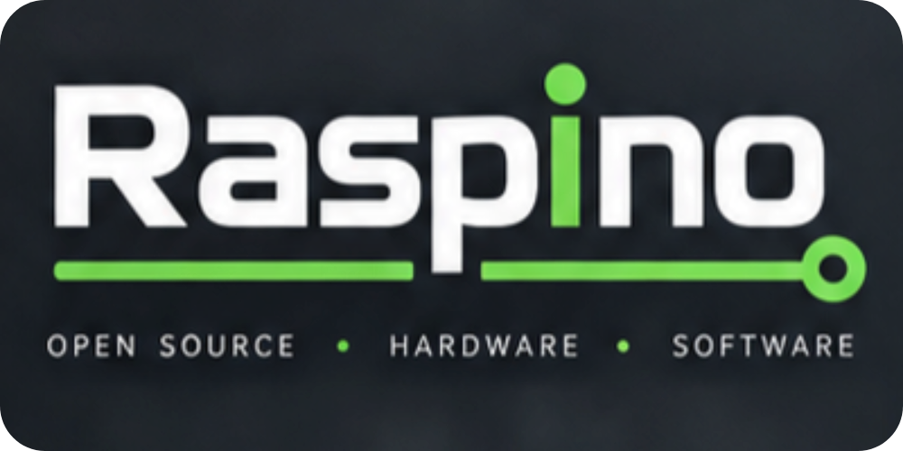
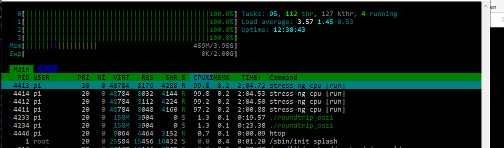

<div align="center"><a href="https://raspino.org">
  </a>
</div>
<br>
<div align="center">C++ on the Raspberry Pi, as easy as Arduino.</div>
<br><br>
<a href="https://github.com/raspino-org/gpiodWrap"><sub>gpiodWrap</sub></a>  <a href="https://github.com/raspino-org/gpiodWrapV1"><sub>gpioWrapV1</sub></a>
<br>  

---
🚨 gpioWrapV1 [v0.1.1] — Hotfix Release

Fixed `getPinChange` initialization bug:  
Upon application startup, an initial level change is no longer incorrectly signaled when a pin is stable at its default level.
The function now silently synchronizes with the pin's current hardware state upon its very first invocation.
An event is triggered only when an actual level change occurs after startup.  

System-wide API protection:  
The `validRequest` guard clause has been consistently implemented across all I/O paths (`setPin`, `getPin`, `getPinChange`, `configurePin`).
Invalid pin offsets and missing chip file descriptors are intercepted immediately at the function entry point, effectively preventing memory access errors (segfaults) and undefined behavior throughout the system.  

CMakeLists:  
Structured generation of binary files within the output directory.
Implementation of `getPinChange` initialization and synchronization:
Introduced a structure to track level changes using C++ bitfields.
The current state (`current`) and the initialization flag (`received`) together occupy **only 2 bits** of memory.
Consequently, the entire `line_change` array for all available GPIO lines consumes only a minimal number of bytes in RAM, ensuring maximum CPU cache efficiency and eliminating any heap overhead.

<div align="center"><a href="https://github.com/raspino-org/gpiodWrapV1/releases/tag/v0.1.1">gpioWrapV1 [v0.1.1]</a></div>

---
📢 gpiodWrapV1 [v0.1.0] — Official Release

Our new flagship, <a href="https://github.com/raspino-org/gpiodWrapV1">gpioWrapV1</a> [v0.1.0], is now officially available in its inaugural version. While we continue to develop gpiodWrap [v2.0] in parallel, V1 offers a powerful preview of the architectural direction we are heading.
As a hardware-oriented wrapper, raw performance is paramount. Consequently, we have entirely eliminated the use of maps and vectors. Our concern is not with the data structures themselves, but rather with preventing frequent heap allocations—which we aim to eliminate entirely from the hot paths.
By allocating a dedicated, fixed memory region for each GPIO line, the framework requires no additional runtime memory allocation. This architectural choice yields significant advantages: the CPU can rapidly access optimized structures that are fetched into the cache in a single operation, bypassing the overhead and complex pointer manipulation typically involved in dynamic lookups.
The result is direct, safe, and predictable access to the hardware registers in just a few CPU clock cycles.

I look forward to hearing your opinions and suggestions.

---
🚀 esp32 vs gpiod-v2

No, it wasn’t a case of working against each other; it was a case of working together.
I’ve conducted a few tests and would like to share them with you.  

Test setup: an ESP32 sends a signal with a period of one microsecond to an event line on my Raspberry Pi 5. The `gpioWrap` callback then forwards these edges to a pin configured as an output. The offset between the two oscilloscope channels (monitoring the ESP32 and the Pi 5 output) is 23 microseconds. To make things a bit more interesting, I also maxed out `stress-ng --cpu` across all cores. There is no jitter and no change in the offset.  

Take a look at the images the results are fantastic.  


  

gpiodWrap:
```
#include <iostream>
#include <chrono>
#include <thread>
#include <atomic>


#include "../../include/gpiodWrap-1.2.3_benchmark.hpp"


gpiodWrap gpio;
using namespace gpiodwrap;

std::atomic<bool> pin_state{false};

int main() {


    gpio.configurePin(23, OUTPUT);
    gpio.bindInterrupt(17, PULLUP, BOTH);

    gpio.watchInterrupt(17, [&]{
        bool newState = !pin_state.load(std::memory_order_relaxed);
        pin_state.store(newState, std::memory_order_relaxed);
        gpio.setPin(23, newState ? HIGH : LOW);
    });

    while (true) {
        std::this_thread::sleep_for(std::chrono::milliseconds(500));
    }

    gpio.closeChip();

    return 0;
}
```

ESP32:
```
const int PIN = 2;

void setup() {
    pinMode(PIN, OUTPUT);
    digitalWrite(PIN, LOW);
}

void loop() {
    digitalWrite(PIN, HIGH);
    delayMicroseconds(500);
    digitalWrite(PIN, LOW);
    delayMicroseconds(500);
} 
```

---
🇩🇪 **C++ auf dem Raspberry Pi, so einfach wie Arduino**

Raspino bildet den Rahmen für unsere Open-Source-Repositories auf GitHub. Wir machen die hardwarenahe Programmierung mit C++ auf dem Raspberry Pi zugänglich, unkompliziert und direkt. 


🇬🇧 **C++ on the Raspberry Pi, as easy as Arduino**  


Raspino provides the framework for our open-source repositories on GitHub. We make low-level programming with C++ on the Raspberry Pi as straightforward, accessible and direct.

---

## 📚 Raspino Repositories
**Public**  
- <a href="https://github.com/raspino-org/gpiodWrap">gpiodWrap</a>&nbsp; &nbsp; &nbsp;<sub>Works with libgpiod 2.x<sub>
- <a href="https://github.com/raspino-org/gpiodWrapV1">gpioWrapV1</a> &nbsp;&nbsp;<sub>Works with libgpiod 1.6.x<sub>
- <a href="https://github.com/raspino-org/mcp23017" alt="mcp23017">mcp23017</a>

**Comming soon**  
- RaspinoCore
  
---

## ⚖️ Disclaimer
** 🇩🇪 **
Raspino ist eine zum Schutz angemeldete Marke und gehört der Community. Die Verwendung des Namens unterliegt unseren Markenrichtlinien.  

⚠️ Wichtige Hinweise (Haftungsausschluss):
Die Bereitstellung der Software erfolgt "wie besehen" (as is) und ohne jegliche ausdrückliche oder implizite Gewährleistung. Die Nutzung des Codes und der Hardware-Ansteuerungen erfolgt vollständig auf eigene Gefahr.  

Die Raspino Open-Source-Initiative und ihre Repositories stehen in keiner Verbindung zur Raspberry Pi Foundation oder Arduino AG. Es handelt sich um eine unabhängige Entwicklung, die von den genannten Marken weder gesponsert noch unterstützt oder autorisiert wird. 


** 🇬🇧 **
Raspino is a trademark filed for protection trademark and belongs to the community. Use of the name is subject to our trademark guidelines.  

⚠️ Important Notice (Disclaimer):  
The software is protection "as is" and without any express or implied warranty. Use of the code and hardware controls is entirely at your own risk.

The Raspino Open-Source Initiative and its repositories are not affiliated with the Raspberry Pi Foundation or Arduino AG. This is an independent development and is neither sponsored, endorsed, nor authorized by the aforementioned brands. All brand names and trademarks used are the property of their respective owners and are used here solely for reference or comp
arison purposes.
